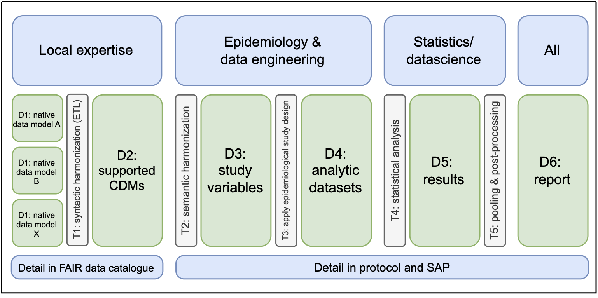

# TARGET-EU CASE STUDY 8: Effectiveness of nirsevimab for RSV-lower respiratory tract infection hospitalization in infants

This repository contains code which implements [case study 8](https://catalogues.ema.europa.eu/node/4897/administrative-details) of the [TARGET-EU project: Comparative effectiveness and safety studies using the target trial emulation and estimand frameworks](https://catalogues.ema.europa.eu/node/4440/administrative-details). The repository contains the code which implements the study design of this case study, along with documentation of that code, and where feasible, dummy data which allows users to run and understand the code. Below we describe briefly the case study and document the repository and its operation. 

## Background
Respiratory syncytial virus (RSV) is the leading cause of lower respiratory tract infection (LRTI) in infants, associated with considerable morbidity and hospitalization. Before nirsevimab introduction, palivizumab was the only licensed preventive measure in Italy, restricted to high-risk infants (including those ≤35 weeks gestational age, chronic lung disease, congenital heart disease). Nirsevimab, a recombinant monoclonal antibody approved by EMA in September 2022, provides sustained protection throughout the RSV season with a single dose by binding to the RSV F protein and preventing viral entry.

The primary objective is to assess the effectiveness of nirsevimab (50 mg or 100 mg based on weight > or < 5kg) in infants (≤12 months) for preventing hospitalisation due to RSV-lower respiratory tract infection compared to infants not receiving nirsevimab 

### EMA Catalogue Entries
[Catalogue Entry of Case Study](https://catalogues.ema.europa.eu/node/4897/administrative-details)

[Protocol & Report](https://catalogues.ema.europa.eu/node/4897/study-documents)

## Repository 

This repository contains all code necessary to reproduce the results contained in the case study report, that is, the analytic pipeline designed to implement the specific study design. The repository does not contain any real data: The real data remains on secure servers, and only fictitious dummy data is shared here for testing, development and illustration purposes. 

The analytic pipeline is conceptualised as a series of transformations (denoted "T") which transform data objects ("D") to other data objects [Gini et al. 2016](https://pmc.ncbi.nlm.nih.gov/articles/PMC4780748/)



The exact analytic pipeline for this study is represented as a graph containing specific data objects and transformation and their relationships [here](https://github.com/target-roc19/case-study-08-rsv-public/blob/main/docs/generic_pipeline_target.png)

Each data object in the pipeline is documented in a corresponding **codebook** which describes how the data object is obtained from its inputs. Thereby, the codebooks specify the implementation of the given study design, which is executed by the scripts in the repository.

### Repository Structure
```
[case-study-01-covid19]
|____configuration
|____data
| |____D2_cdm
| |____D3_study_variables
| |____D4_analytic_datasets
| |____D5_results
| |____D6_report
|____docs
| |____codebook
|____logs
|____run
|____tests
|____transformations
| |____T2_semantic_harmonization
| |____T3_study_design
| |____T4_statistical_analysis
| |____T5_processing_results
|____CHANGELOG.md
|____LICENSE
|____README.md
```

- The `data/D2_cdm` folder contains the base input data, following a Common Data Model (CDM) structure, in this case the [ConcePTION](https://github.com/IMI-ConcePTION/ConceptionTools/wiki) CDM.
- The `transformations` folder contains the scripts which compose the analytic pipeline
- Intermediate data objects created by `transformations` are stored in the other `data` subfolders
- The `docs/codebook` folder contains the study codebooks describing each intermediate data object
- The `transformations/common_configuration/RWE-BRIDGE` folder contains all project metadata, including events, medicines and vaccine codelists used in the study, as well as other metadata files specifying definitions of study concepts and variables. 

### Dummy Data
- Test data for a number of intermediate data objects can be found in `tests/testthat/test_data`
- Synthetic CDM will be made publicly available soon, in the mean time available on request from the programming team (below)

## How to Run
1. Store dummy CDM in `data/D2_cdm`
2. Update data path in `configuration/config_project.yaml`, `DEAP_configuration$data_instance`
3. Run the full pipeline with:

```
run/run_pipeline.R
```
Or run specific steps, e.g.:

```
run/run_T2.R
```

- Which parts of the pipeline are executed can be configured through `configuration/config_pipeline.yaml`
- More specifically which scripts are executed in each part can be configured through `configuration/config_TX.yaml`.
- `config_project.yaml` defines which objects along which paths are used as inputs to different scripts in the pipeline, including the input CDM instance.

## Testing
Run tests with:

```
Rscript -e 'for (f in list.files("tests/testthat", pattern = "^test.*[.]R$", full.names = TRUE)) { source(f) }'
```

Alternative in VS Code:

1. Open Command Palette (`Cmd+Shift+P`) and run `Tasks: Run Task`.
2. Select `Run local R tests`.

## License
See [License](https://github.com/target-roc19/case-study-08-rsv-public/LICENSE.txt)

## Open Science Badges
<a href='https://doi.org/10.25937/krp4-g724'>

</a>


## Contact
For questions or support, contact:
- Case Study Lead
    - Name: Elisa Barbieri
    - Email: elisa.barbieri@unipd.it
- Lead Programmer
    - Name: Yinan Mao
    - Email: y.mao@umcutrecht.nl
- Programming Team
    - Name: University Medical Center Utrecht
    - Email: wp2.targeteu@umcutrecht.nl
